<a id="top"></a>

<p align="center">
  <a href="https://scopelock-536j.onrender.com">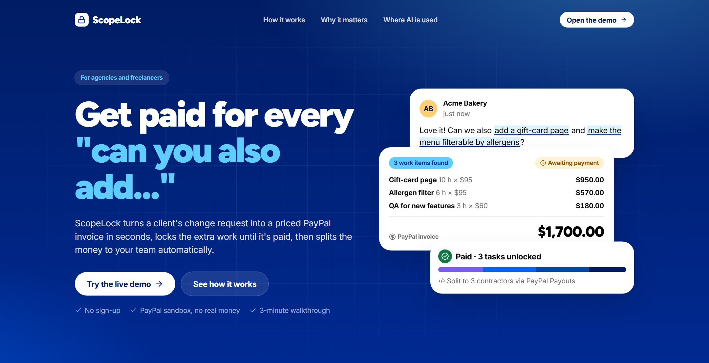</a>
</p>

<p align="center">
  <b>Turn a client's "can you also add..." into a priced PayPal invoice, lock the extra work until it is paid, then split the money across the team.</b>
</p>

<p align="center">
  <a href="https://scopelock-536j.onrender.com"></a>
  <a href="https://youtu.be/MU3-c1BZmq0"></a>
  <a href="#run-it"></a>
  <a href="#tests"></a>
  <a href="LICENSE"></a>
  <br>
  <a href="#paypal-integration"></a>
  <a href="#where-the-model-sits-and-where-it-does-not"></a>
  <a href="#architecture"></a>
  <a href="#architecture"></a>
</p>

<p align="center">
  <a href="#see-it-work">See it work</a> ·
  <a href="#try-it-now">Try it now</a> ·
  <a href="#friday-452-pm">The problem</a> ·
  <a href="#the-loop-step-by-step">The loop</a> ·
  <a href="#one-request-in-numbers">In numbers</a> ·
  <a href="#what-could-go-wrong">What could go wrong</a> ·
  <a href="#architecture">Architecture</a> ·
  <a href="#every-screen">Every screen</a> ·
  <a href="#run-it">Run it</a>
</p>

> Built for *Build What's Next with PayPal and AI*. Everything runs in the PayPal sandbox or a local simulator. No real money moves, and all the data is fake.

---

## See it work

<table>
<tr>
<td width="50%" align="center">
  <a href="https://youtu.be/MU3-c1BZmq0"></a>
  <br><b><a href="https://youtu.be/MU3-c1BZmq0">Watch the demo video</a></b>
</td>
<td width="50%" align="center">
  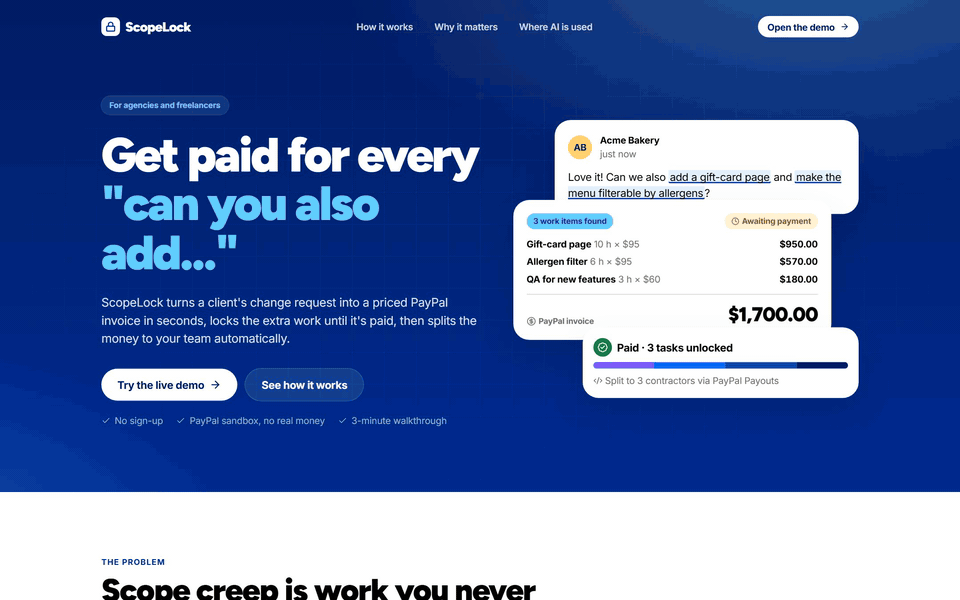
  <br><b>The whole loop, screen by screen</b>
</td>
</tr>
</table>

## Try it now

Every link opens that screen on the [hosted demo](https://scopelock-536j.onrender.com). It runs on a free tier that sleeps when idle, so the first load can take about a minute. No sign-up is needed.

| Step | Open | What to do there |
|:---:|---|---|
| 1 | [**Overview**](https://scopelock-536j.onrender.com/projects/demo) | See the money, the milestones and the locked Launch phase. |
| 2 | [**Change requests**](https://scopelock-536j.onrender.com/projects/demo/requests) | Pick a sample message, press <kbd>Analyze</kbd>, then <kbd>Create invoice & send</kbd>. |
| 3 | [**Invoices**](https://scopelock-536j.onrender.com/projects/demo/invoices) | Press <kbd>Pay as the client</kbd>. Turn on *Simulate declined card* to see the failure and the retry. |
| 4 | [**Overview**](https://scopelock-536j.onrender.com/projects/demo) | Watch the locked tasks open on the timeline. |
| 5 | [**Pay the team**](https://scopelock-536j.onrender.com/projects/demo/team) | When all six checks pass, press <kbd>Pay contractors</kbd>. |
| 6 | [**Money log**](https://scopelock-536j.onrender.com/projects/demo/ledger) | Press <kbd>Ask</kbd> and type `unpaid invoices over $500`. |

The whole loop takes about three minutes. The demo is shared, so if someone has already been through it, press <kbd>Reset demo</kbd> in the sidebar. The sidebar also tracks the journey and always links to the next action.

## Friday, 4:52 pm

You run a small agency, and you are three weeks into a fixed-price store for a bakery. A message arrives:

> *Love it! Can we also add a gift-card page and make the menu filterable by allergens? Need it before the holiday launch.*

It is friendly, and it is about $1,700 of work. To charge for it you have to scope it, price it, write an invoice, explain why launch moves, chase the payment, and then work out what each freelancer is owed. For one small request, that is enough friction that most people quietly say *sure, no problem*.

| What goes wrong today | What ScopeLock does |
|---|---|
| Requests hide in chat, never as a purchase order | Reads the message and lists the work, quoting the client's own words |
| Pricing each small ask takes too long | Prices every item from your rate card in code, in seconds |
| Work starts before the money arrives | Puts the new tasks on the timeline, locked, until the invoice is paid |
| Splitting each payment is a spreadsheet and a round of transfers | Runs six checks, then sends one PayPal Payouts batch |

<sub>The scene is illustrative. The message and the numbers are the ones in the shipped demo project.</sub>

## The loop, step by step

Click any screenshot for the full-size image.

### 1. Paste the client's message

Paste what the client sent, or pick one of three samples: new features with a deadline, a simple add-on, or vague feedback. Gemini 2.5 Flash turns it into structured work items with a title, role, hours, confidence, whether it was already in scope, and the exact quote it came from.

<p align="center"><a href="docs/screenshots/04-request-message.jpg">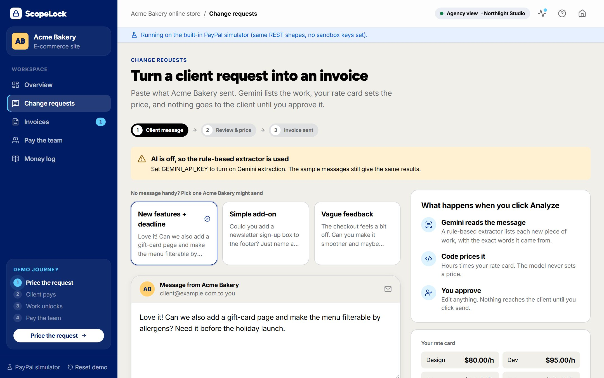</a></p>

### 2. Review and price

Every phrase that produced work is highlighted in the original message. You can untick anything you will do for free, or change the role and hours, and the price updates. Prices come from the project's rate card, never from the model. The panel on the right shows how far the new work pushes launch.

<p align="center"><a href="docs/screenshots/05-review-and-price.jpg">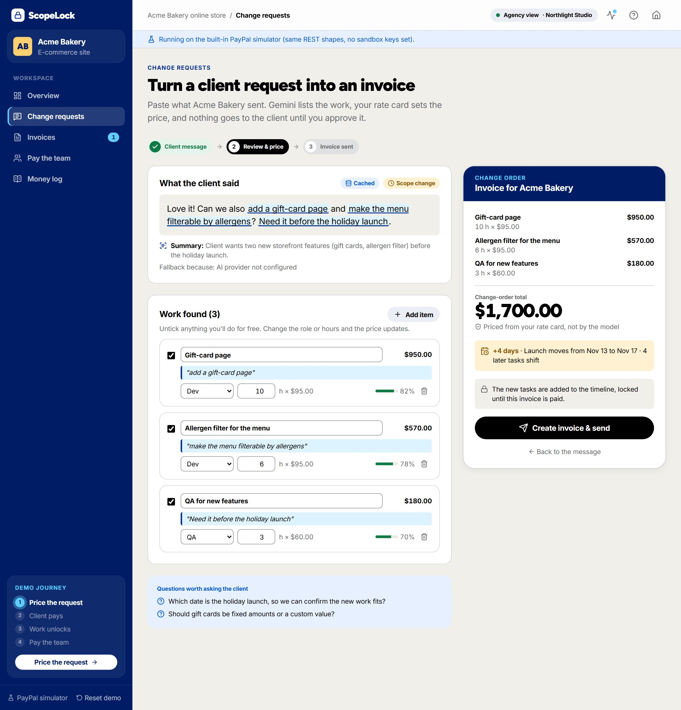</a></p>

### 3. Send the invoice, and the work goes on the timeline locked

One click creates and sends a PayPal invoice through Invoicing v2. The new tasks appear on the Gantt chart with a padlock, and everything downstream shifts.

<table>
<tr>
<td width="50%"><a href="docs/screenshots/06-invoice-sent.jpg">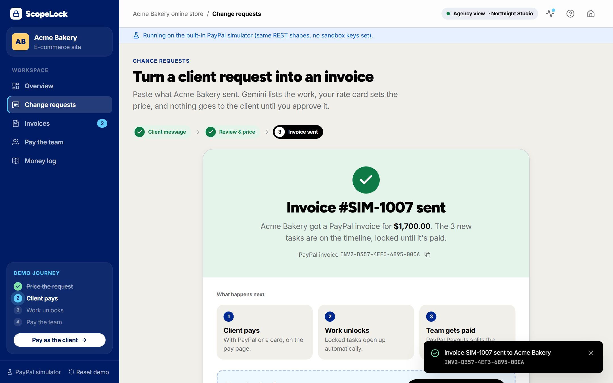</a><br><b>Invoice sent.</b> A hand-off to the client view.</td>
<td width="50%"><a href="docs/screenshots/07-new-work-locked.jpg">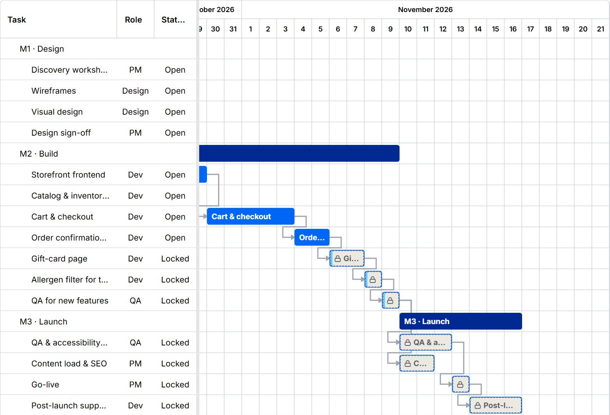</a><br><b>Locked.</b> Three new tasks wait for this invoice.</td>
</tr>
</table>

### 4. The client pays, and a declined card is handled

The client sees an itemised pay page. Orders are created and captured on the server through Orders v2, with the PayPal JS SDK v6 button in the browser. A demo control forces `INSTRUMENT_DECLINED` through the `PayPal-Mock-Response` header, so you can see the failure and the retry.

<table>
<tr>
<td width="33%"><a href="docs/screenshots/09-client-pay-page.jpg">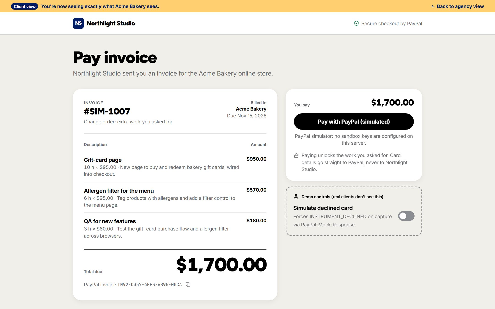</a><br><b>Pay page.</b> What the client sees.</td>
<td width="33%"><a href="docs/screenshots/10-card-declined.jpg">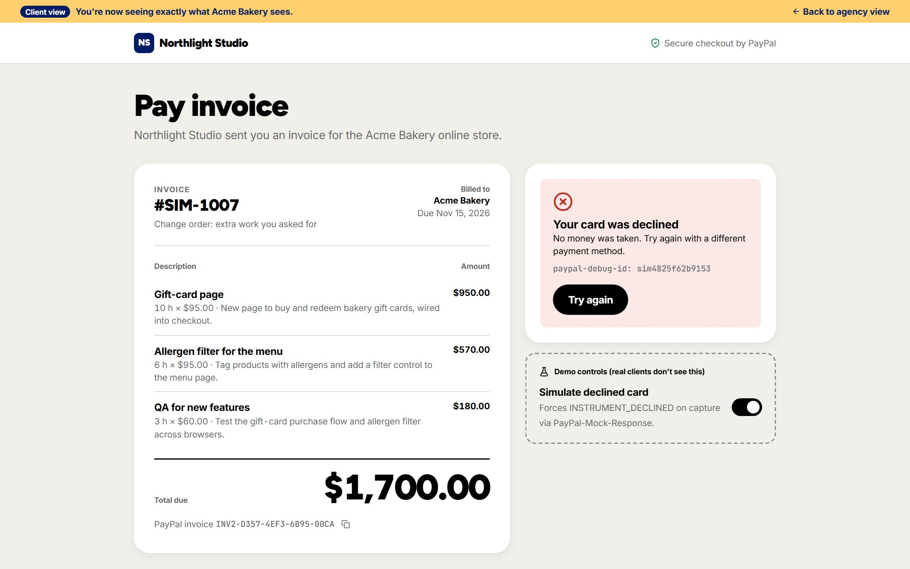</a><br><b>Declined.</b> No money taken, with a clear retry.</td>
<td width="33%"><a href="docs/screenshots/11-payment-received.jpg">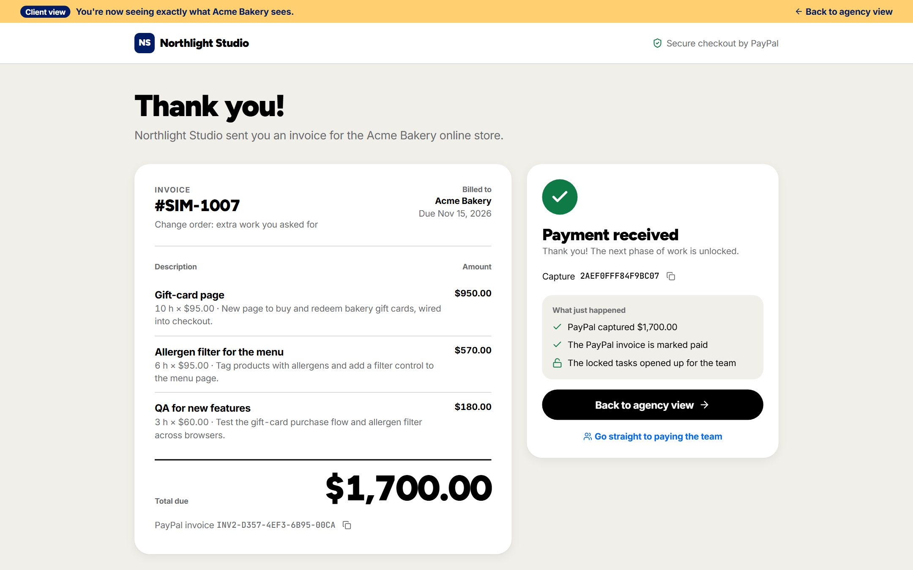</a><br><b>Paid.</b> Captured and recorded on the invoice.</td>
</tr>
</table>

### 5. The work unlocks

The capture is recorded on the PayPal invoice and the three tasks open up. The Launch phase stays locked, because it waits on its own invoice: paying for the extras does not pay for the Build milestone.

<p align="center"><a href="docs/screenshots/12b-timeline-unlocked.jpg">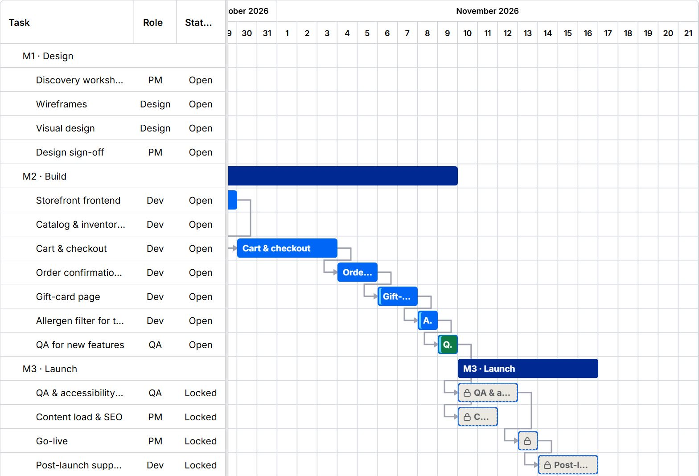</a></p>

### 6. Pay the team

Six deterministic checks run, then a single Payouts v1 batch splits the money across three contractors and the agency keeps its margin. If any check fails, the button is disabled.

<table>
<tr>
<td width="50%"><a href="docs/screenshots/13-pay-the-team.jpg">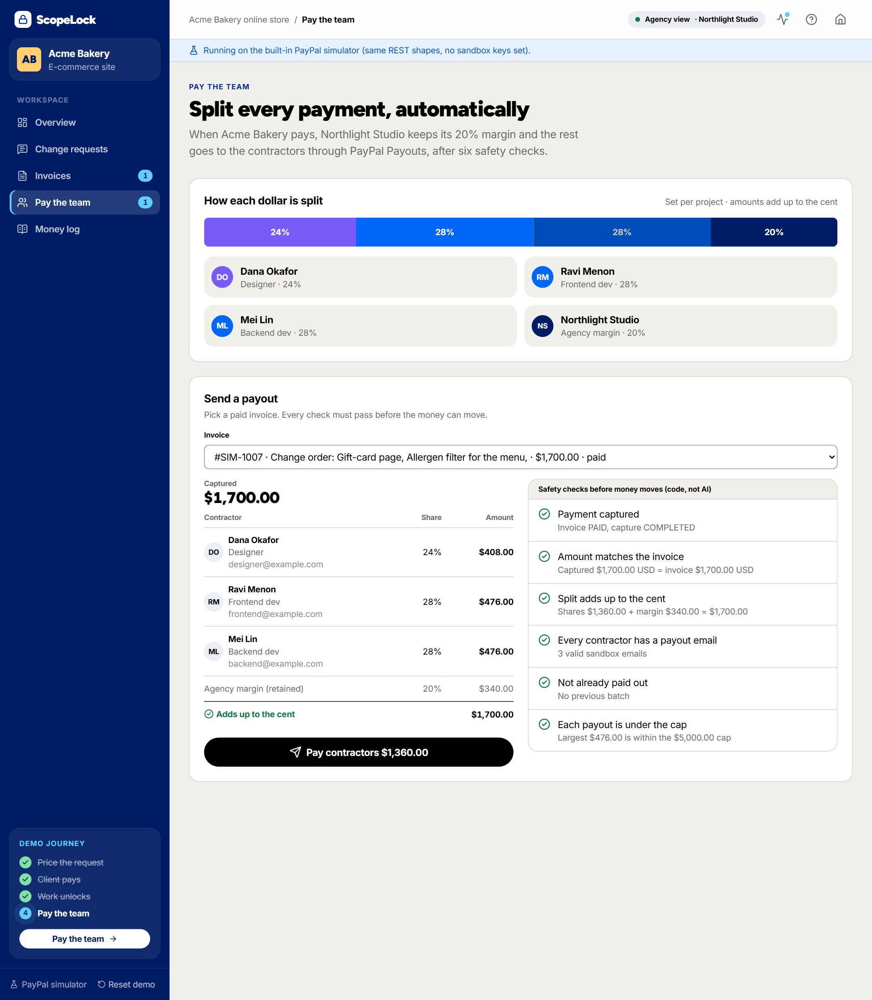</a><br><b>Before.</b> The split and the six checks.</td>
<td width="50%"><a href="docs/screenshots/14-payout-success.jpg">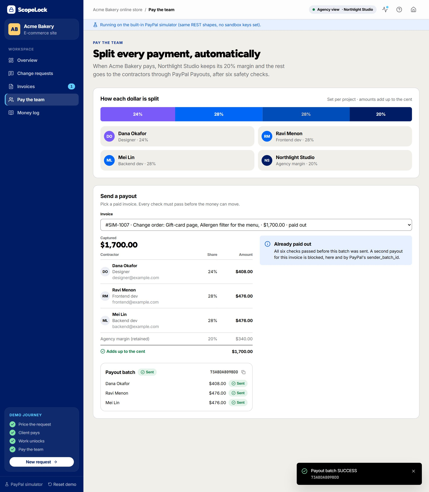</a><br><b>After.</b> Batch sent, and a second one is blocked.</td>
</tr>
</table>

### 7. Keep the record

An AG Grid ledger lists every invoice, payment and payout with its PayPal reference, plus quick search, a plain-English filter, totals and CSV export.

<p align="center"><a href="docs/screenshots/16-money-log.jpg">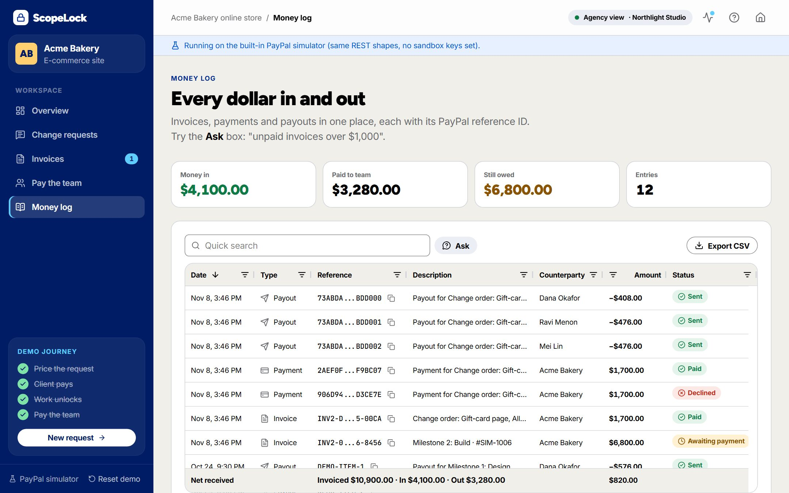</a></p>

## One request in numbers

The sample message above, followed through the code.

### Pricing

Hours rounded to the nearest half hour, multiplied by the role's rate.

| Work item | Quote it came from | Role | Hours | Rate | Amount |
|---|---|---|---:|---:|---:|
| Gift-card page | "add a gift-card page" | Dev | 10 | $95 | $950.00 |
| Allergen filter for the menu | "make the menu filterable by allergens" | Dev | 6 | $95 | $570.00 |
| QA for new features | "Need it before the holiday launch" | QA | 3 | $60 | $180.00 |
| | | | | **Total** | **$1,700.00** |

### Schedule

Each item becomes a task at 6 productive hours a day.

| Task | Hours | Days |
|---|---:|---:|
| Gift-card page | 10 | 2 |
| Allergen filter for the menu | 6 | 1 |
| QA for new features | 3 | 1 |
| **Launch moves by** | | **4** |

The new tasks are chained after the milestone's last task, and every task that depends on it moves right by the same amount.

### Payout

Margin off the top, the rest shared by split, rounded so it always adds up.

| Recipient | Share of the pool | Share of the total | Amount |
|---|---:|---:|---:|
| Northlight Studio (agency margin, retained) | | 20% | $340.00 |
| Dana Okafor, designer | 30% | 24% | $408.00 |
| Ravi Menon, frontend | 35% | 28% | $476.00 |
| Mei Lin, backend | 35% | 28% | $476.00 |
| **Total captured** | | **100%** | **$1,700.00** |

Rounding uses the largest-remainder method over integer cents, so margin plus shares always equals the captured amount exactly.

## What could go wrong

| If this happens | What ScopeLock does | Code |
|---|---|---|
| The model invents a work item the client never asked for | Every item must carry a `sourceQuote`, and any item whose quote is not in the client's message is dropped. | [`parse.ts`](lib/ai/parse.ts) |
| The model returns broken JSON, or Gemini is down or rate limited | Invalid output is retried once with the error attached. A second failure, a timeout or a provider error hands over to a rule-based extractor, and the screen says why. | [`extract.ts`](lib/ai/extract.ts) |
| The client's message tries to instruct the model | The message is treated as untrusted data. The output is a validated list of items, and the model cannot set a price, call PayPal or approve anything. | [`prompts.ts`](lib/ai/prompts.ts) |
| The client pays twice | An already paid invoice returns `409 ALREADY_PAID` before PayPal is called, and PayPal's own `invoice_id` guard maps to the same error. | [`payments.ts`](lib/app/payments.ts) |
| The card is declined | The payment is recorded as `DECLINED`, no money is taken, and the client gets a retry with a new idempotency key. | [`payments.ts`](lib/app/payments.ts) |
| The network drops halfway through a PayPal call | Every POST must carry a `PayPal-Request-Id` built from our record IDs, so a retry replays the operation instead of repeating it. | [`request.ts`](lib/paypal/request.ts) |
| Someone presses Pay contractors twice | Three layers stop it: a `409` from the server, a unique database constraint on the batch's `invoice_id`, and PayPal's `sender_batch_id`. | [`payouts.ts`](lib/app/payouts.ts) |
| A payout does not add up, goes to a bad address, or is too large | All six checks below must pass, and the server runs them again when the batch is sent. | [`checks.ts`](lib/domain/checks.ts) |
| Floating-point arithmetic loses a cent | Money is integer cents everywhere, and becomes a decimal string only at the PayPal boundary. | [`money.ts`](lib/domain/money.ts) |

### The six checks before a payout

| Check | Passes when |
|---|---|
| Payment captured | The invoice is `PAID` and the capture is `COMPLETED` |
| Amount matches the invoice | Captured amount and currency equal the invoice |
| Split adds up to the cent | Shares plus margin equal the captured amount |
| Every contractor has a payout email | At least one share, and every email is valid |
| Not already paid out | No batch exists for this invoice |
| Each payout is under the cap | No share exceeds `PAYOUT_CAP_CENTS` ($5,000 by default) |

### Where the model sits, and where it does not

| | Gemini | Code | A person |
|---|:---:|:---:|:---:|
| Read the message and list work items | Yes | | |
| Draft a payment reminder | Yes | | |
| Turn a plain-English question into a ledger filter | Yes | | |
| Set a price | | Yes | |
| Decide what is locked | | Yes | |
| Calculate the split and run the checks | | Yes | |
| Edit the items and approve the invoice | | | Yes |
| Press the button that moves money | | | Yes |

The reminder and the ledger filter each have a non-AI fallback, and the filter can only produce a strict, validated shape that code maps onto the grid.

## How it works

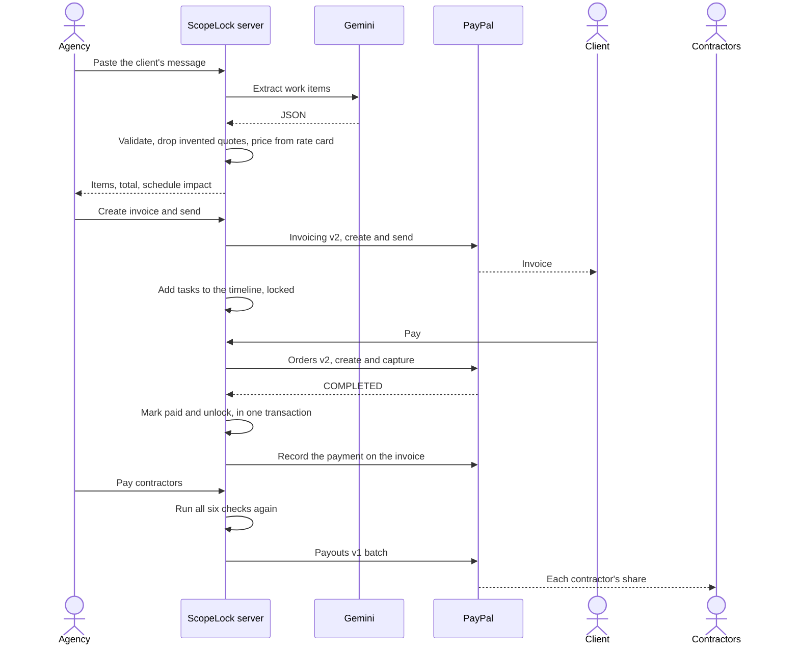

### How a task gets locked

A task has two possible blockers. Both come from [`lib/domain/gating.ts`](lib/domain/gating.ts), a pure function with its own unit tests.

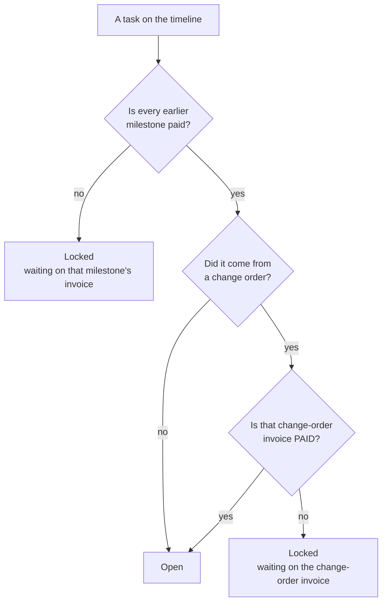

## Architecture

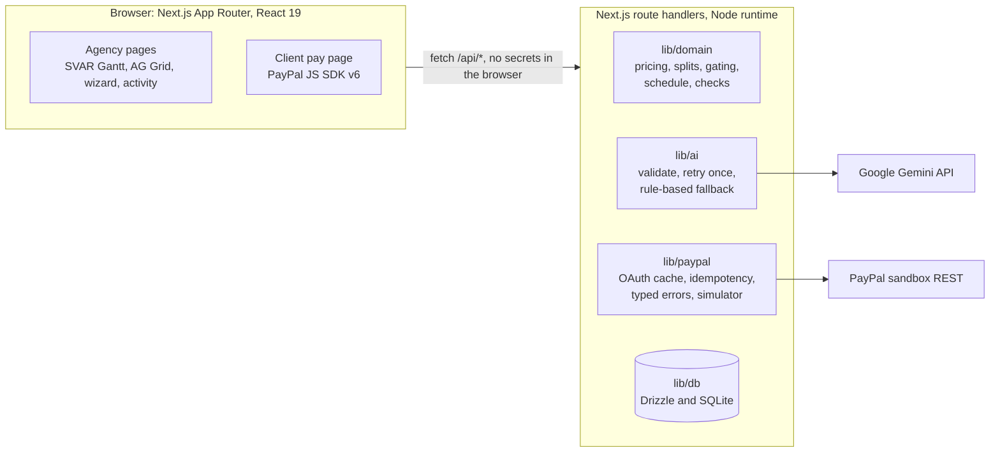

### PayPal integration

| API | Used for | Idempotency |
|---|---|---|
| Invoicing v2 | Creating, sending, reminding and syncing milestone and change-order invoices | `PayPal-Request-Id` from our record IDs |
| Orders v2 | Creating and capturing the order on the server | `order-{invoice}-{attempt}`, `capture-{invoice}-{attempt}` |
| JS SDK v6 | The PayPal button on the client's pay page | Not applicable |
| Payouts v1 | Splitting each payment between contractors | `sender_batch_id` of `co-{invoice}` |

### Built with

| Layer | Tools |
|---|---|
| App | Next.js 16, React 19, TypeScript, Tailwind CSS 4, lucide-react |
| Timeline and grid | SVAR React Gantt, AG Grid Community |
| Data | better-sqlite3, Drizzle ORM, Zod |
| Language model | Google Gemini 2.5 Flash through the Vercel AI SDK and Google's OpenAI-compatible endpoint |
| Payments | PayPal Invoicing v2, Orders v2, JS SDK v6, Payouts v1 |
| Tests | Vitest, Playwright |
| Hosting | Render |

### Project map

```text
app/                 Pages and API route handlers
components/
  pages/             Overview, request wizard, section pages
  checkout/          Client pay page and PayPal button
  gantt/             Timeline
  ledger/            Money log grid
  payouts/           Split, checks and batch
lib/
  domain/            Pure logic: money, pricing, splits, gating, schedule, checks
  ai/                Extraction, parsing, prompts, samples, fallback
  paypal/            Auth, request wrapper, invoices, orders, payouts, simulator
  app/               Change orders, invoicing, payments, payouts
  db/                Schema, client, seed
tests/
  unit/              Vitest
  e2e/               Playwright
scripts/             PayPal sandbox smoke test
```

<p align="right"><a href="#top">Back to top</a></p>

## Every screen

These are screenshots of the running app, taken locally on the built-in PayPal simulator with no keys set. That is why a blue banner appears and the pay button says *simulated*. The [hosted demo](https://scopelock-536j.onrender.com) runs against the real PayPal sandbox. Click any image for the full size.

<table>
<tr>
<td width="50%"><a href="docs/screenshots/01-landing.jpg"></a><br><b>Landing.</b> The problem, how it works, the guard rails, and a link into the demo.</td>
<td width="50%"><a href="docs/screenshots/02-overview.jpg">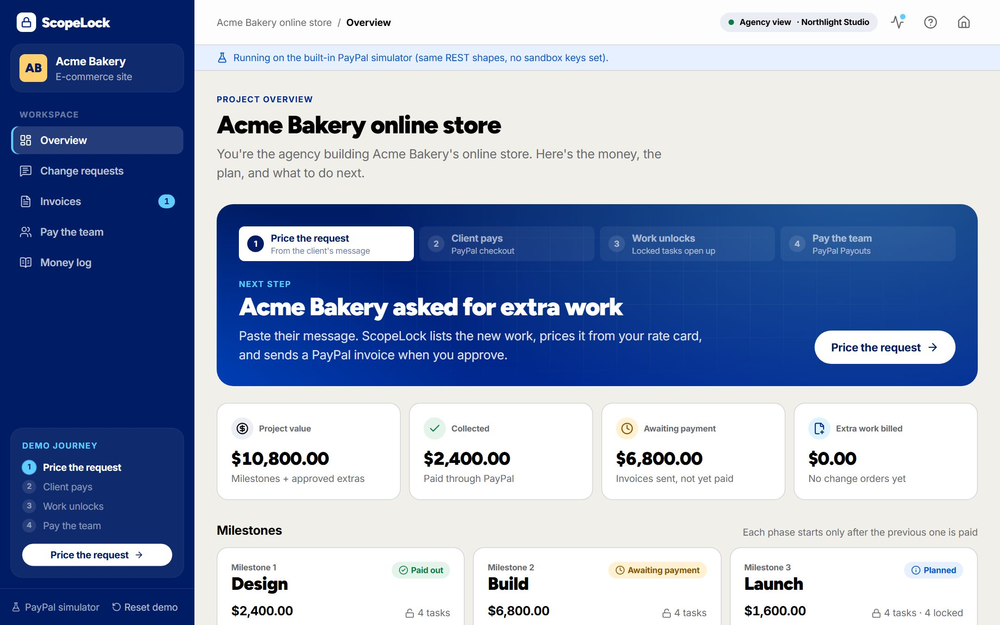</a><br><b>Overview.</b> The next step, the money, and the milestones.</td>
</tr>
<tr>
<td><a href="docs/screenshots/03-timeline-locked.jpg">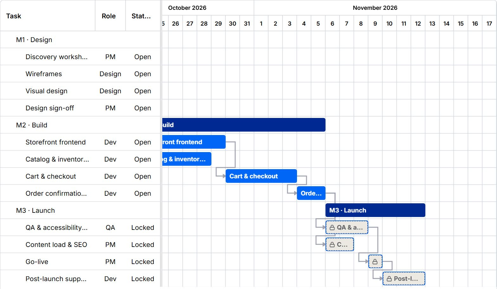</a><br><b>Timeline.</b> Each phase starts only after the previous one is paid.</td>
<td><a href="docs/screenshots/08-invoices.jpg">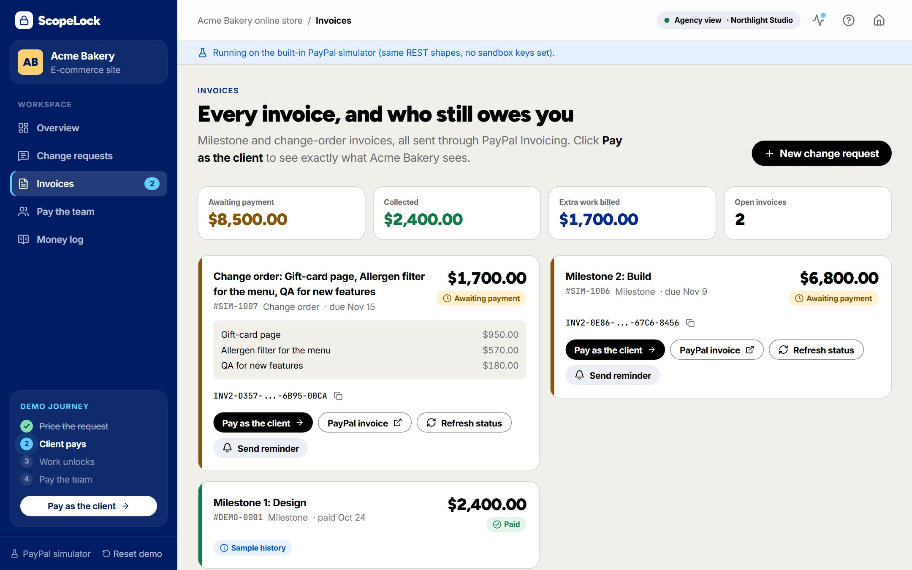</a><br><b>Invoices.</b> Every invoice, who still owes you, and reminders.</td>
</tr>
<tr>
<td><a href="docs/screenshots/12-work-unlocked.jpg">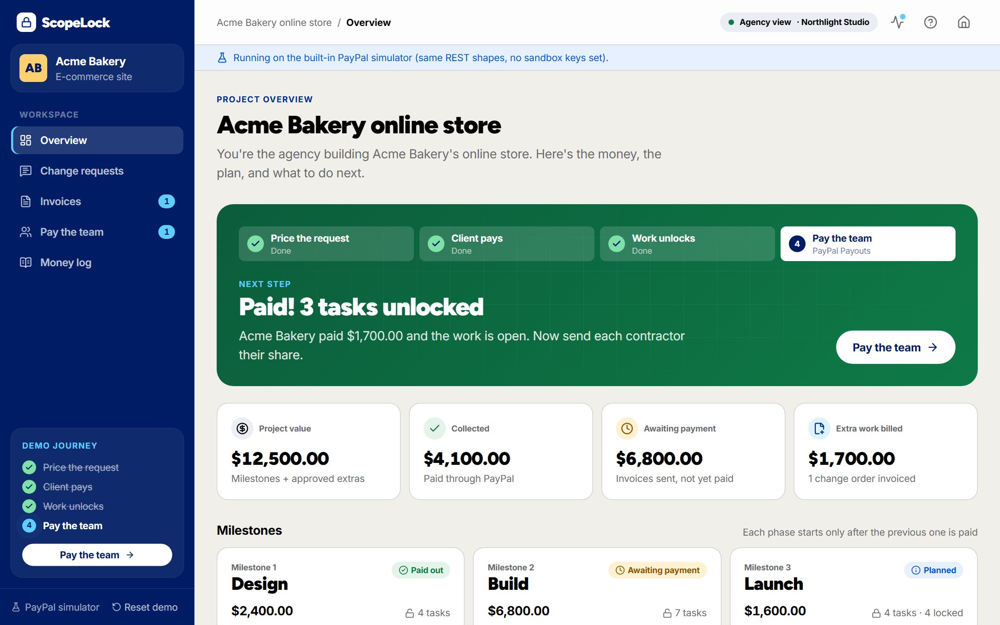</a><br><b>Unlocked.</b> The guide moves on to paying the team.</td>
<td><a href="docs/screenshots/15-journey-complete.jpg">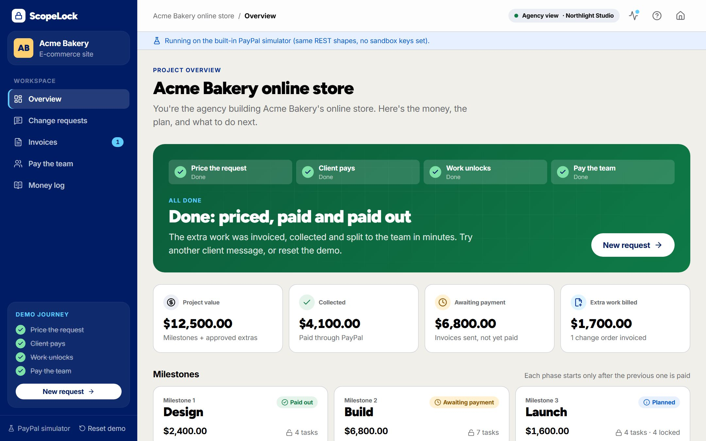</a><br><b>Done.</b> Priced, paid and paid out.</td>
</tr>
<tr>
<td><a href="docs/screenshots/17-money-log-ask.jpg">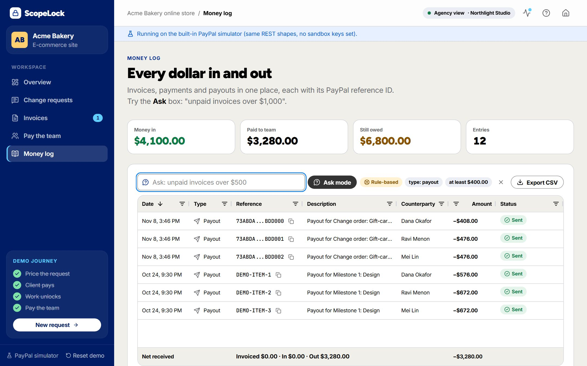</a><br><b>Ask the ledger.</b> "payouts over $400" becomes a filter, with its source labelled.</td>
<td><a href="docs/screenshots/18-activity.jpg">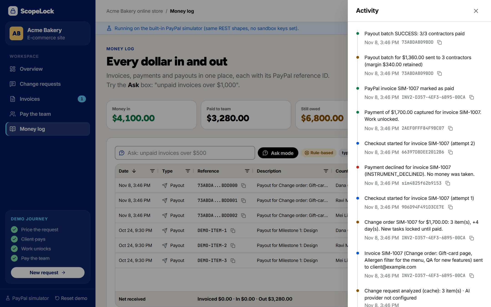</a><br><b>Activity.</b> Every event, with its PayPal reference.</td>
</tr>
<tr>
<td><a href="docs/screenshots/19-demo-guide.jpg">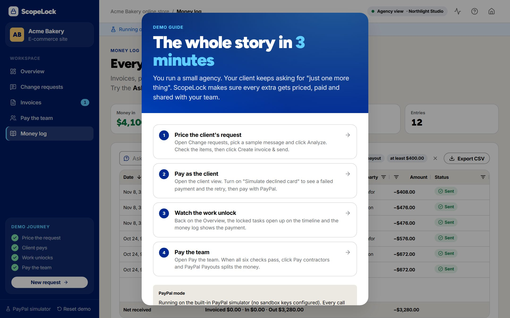</a><br><b>Demo guide.</b> The whole story in four steps, from the help icon.</td>
<td><a href="docs/screenshots/20-health.jpg">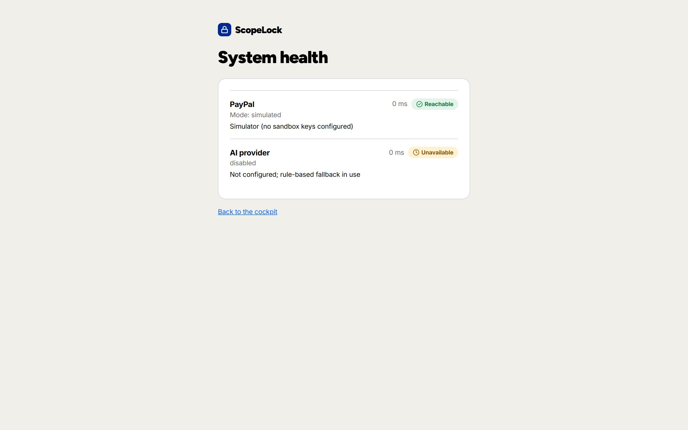</a><br><b>Health.</b> Whether PayPal and the model are reachable.</td>
</tr>
</table>

<p align="center">
  <a href="docs/screenshots/21-phone-landing.jpg">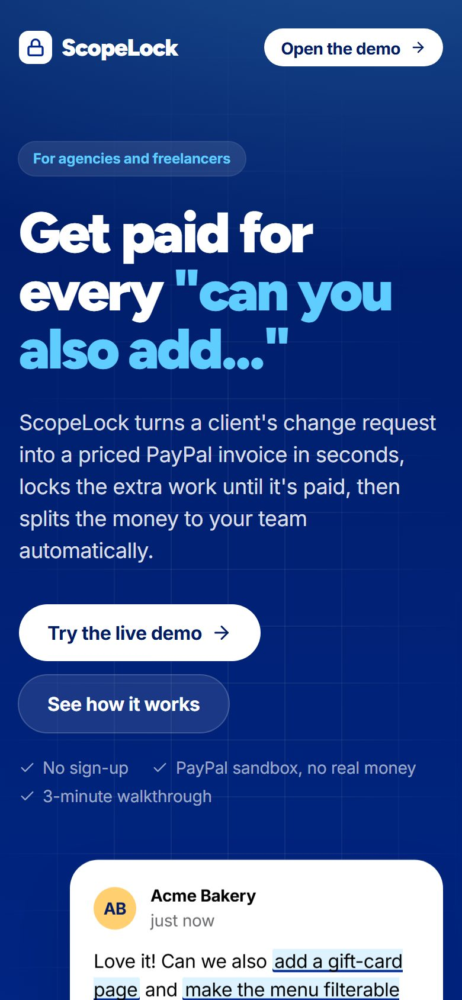</a>
  &nbsp;&nbsp;
  <a href="docs/screenshots/22-phone-overview.jpg">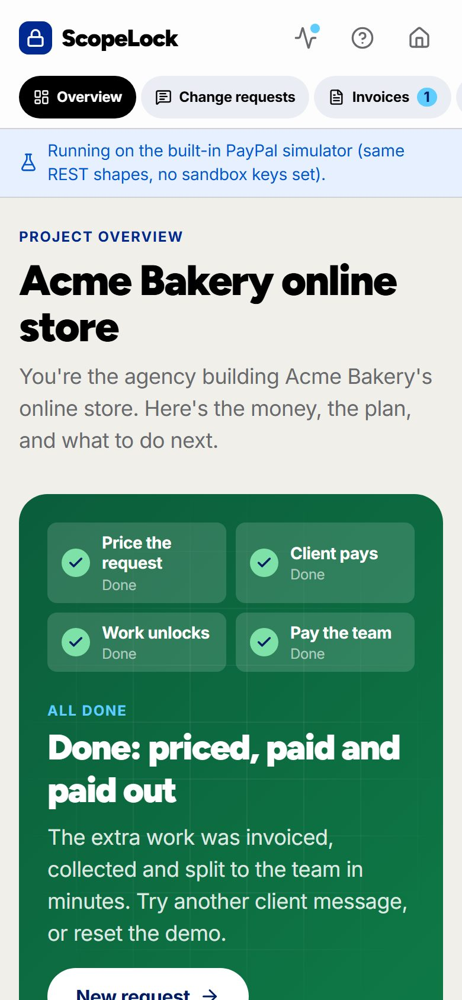</a>
  &nbsp;&nbsp;
  <a href="docs/screenshots/23-phone-pay.jpg">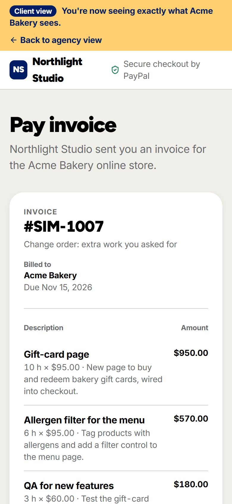</a>
  <br><sub>It also works on a phone, which is where a client is likely to open an invoice.</sub>
</p>

## Run it

Requires Node.js 22 or later. With no keys at all, ScopeLock runs the full loop on its built-in PayPal simulator and rule-based extractor.

```bash
git clone https://github.com/SanTiwari07/ScopeLock.git
```

```bash
cd ScopeLock
```

```bash
npm install
```

```bash
cp .env.example .env
```

```bash
npm run dev
```

Open <http://localhost:3000>. The database re-seeds every time the server starts, and <kbd>Reset demo</kbd> restores the starting state.

### Connect the real PayPal sandbox

1. Create an app at [developer.paypal.com](https://developer.paypal.com) under Apps & Credentials, Sandbox.
2. Make sure Payouts is enabled on the sandbox business account.
3. Set these in `.env`:

| Variable | Value |
|---|---|
| `PAYPAL_CLIENT_ID` | Sandbox client ID |
| `PAYPAL_CLIENT_SECRET` | Sandbox secret |
| `DEMO_CLIENT_EMAIL` | A personal sandbox account that pays invoices |
| `DEMO_CONTRACTOR_EMAILS` | Three personal sandbox accounts, comma separated |

4. Run the smoke test:

```bash
npm run smoke
```

### Connect Gemini

Get a free key at [aistudio.google.com](https://aistudio.google.com/apikey) and set it in `.env`:

```text
GEMINI_API_KEY=your-key
GEMINI_MODEL=gemini-2.5-flash
```

Check the connection at `/health`.

### What the simulator does

[`lib/paypal/sim.ts`](lib/paypal/sim.ts) answers the same REST paths with the same response shapes, idempotency replay, mock-response failures and duplicate guards. The UI labels this mode clearly. It exists for offline development and tests.

### Deploy on Render

[`render.yaml`](render.yaml) defines a free Node web service. Set `PAYPAL_CLIENT_ID`, `PAYPAL_CLIENT_SECRET`, `GEMINI_API_KEY` and the sandbox emails in the Render dashboard, and never commit them. The free disk is wiped when the service sleeps, so every cold start is a fresh demo.

### Commands

| Command | What it does |
|---|---|
| `npm run dev` | Development server |
| `npm run build` then `npm start` | Production build and server |
| `npm test` | Unit tests |
| `npm run test:e2e` | Playwright happy path, simulator mode. Run `npx playwright install chromium` first |
| `npm run smoke` | PayPal sandbox smoke test, needs real sandbox keys |
| `npm run lint` | ESLint |
| `npm run typecheck` | TypeScript |

### Tests

33 unit tests across 7 files, on the logic that handles money and locks, plus one Playwright test that walks the entire loop from the landing page to a finished payout, including the declined card and both duplicate guards.

| Area | Tests |
|---|---:|
| AI parsing and fallback | 8 |
| Payout splits | 5 |
| Pre-payout checks | 5 |
| Money | 4 |
| Schedule | 4 |
| Gating | 4 |
| Pricing | 3 |

## Current limits

This is a hackathon build, and these are the honest edges:

- **One demo project.** The app seeds a single project and has no sign-in, so it is a working demonstration and not yet a multi-tenant product.
- **Sandbox only.** It is set up for the PayPal sandbox, not live payments.
- **Data does not persist.** SQLite is wiped and re-seeded on every boot.
- **Hour estimates are suggestions.** The model proposes the hours, and a person is expected to review them before invoicing.

## Credits and licence

Built by team **HoloDuet**: [Sanskar Tiwari](https://github.com/SanTiwari07) and [Shambhavi Patil](https://github.com/Shambhavi500). Development began in the team's first repository, [Shambhavi500/ScopeLock](https://github.com/Shambhavi500/ScopeLock), and this repository is where the team's submission lives. Released under the [MIT licence](LICENSE). All data in this project is fake.

<p align="right"><a href="#top">Back to top</a></p>
